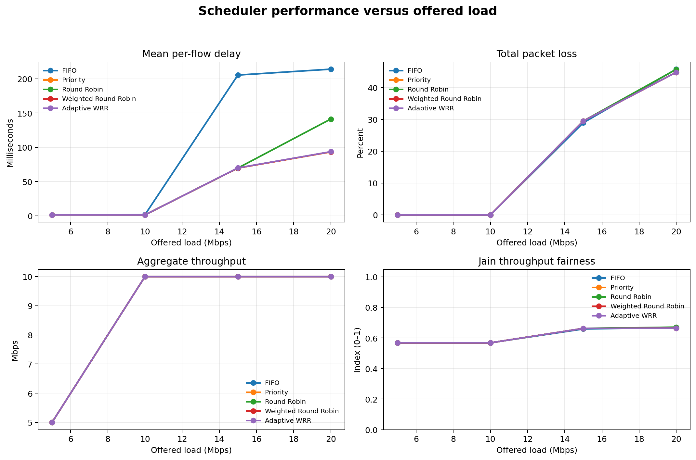
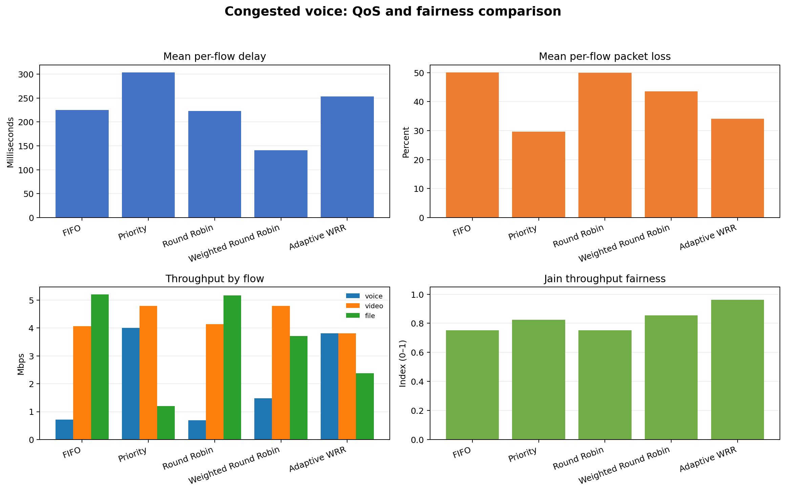
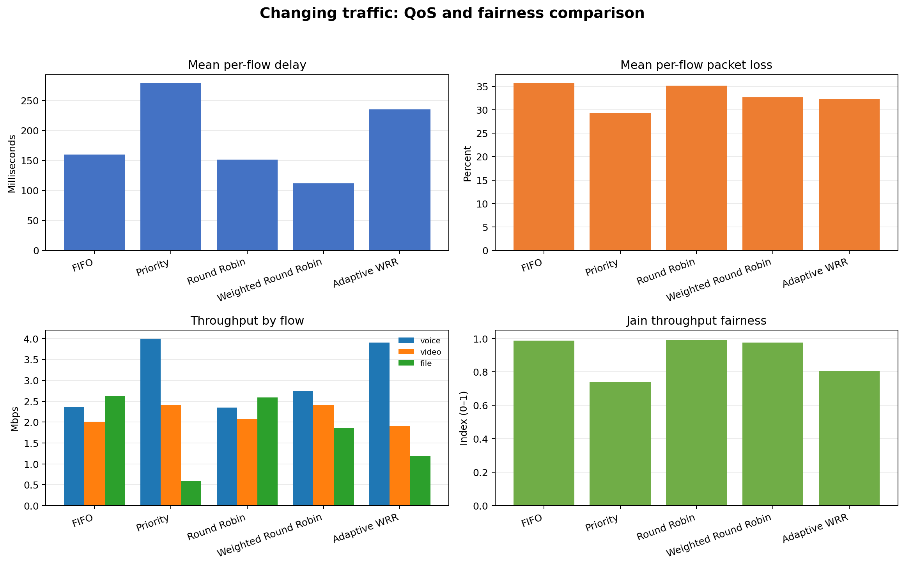
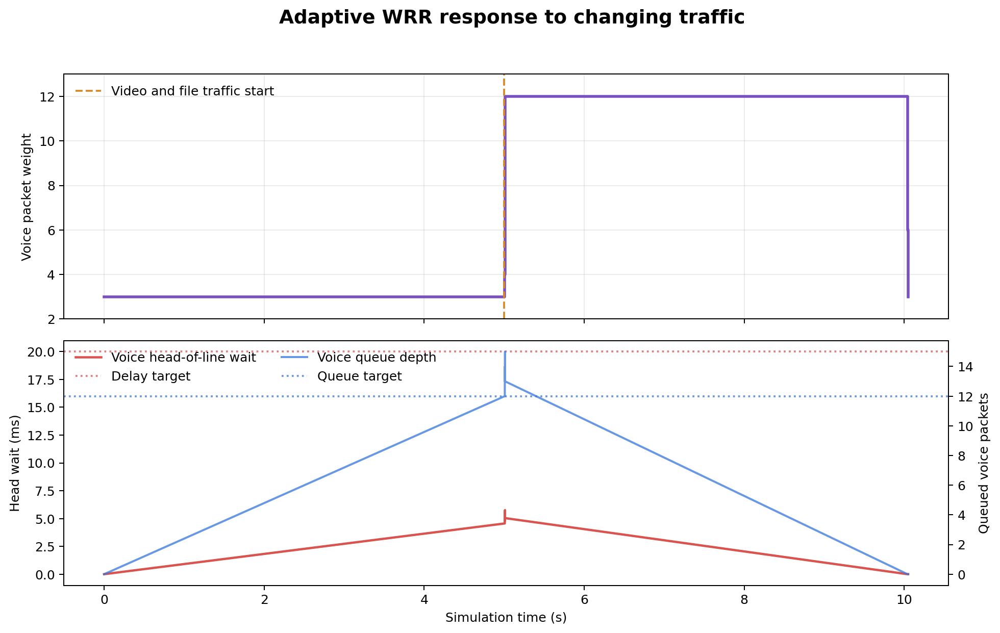
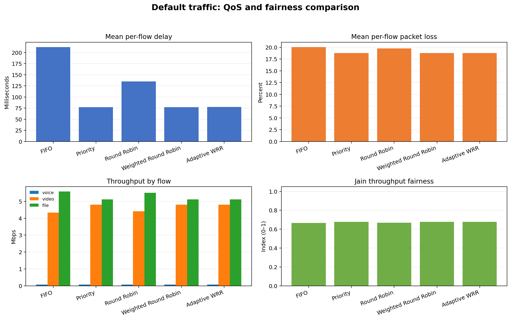
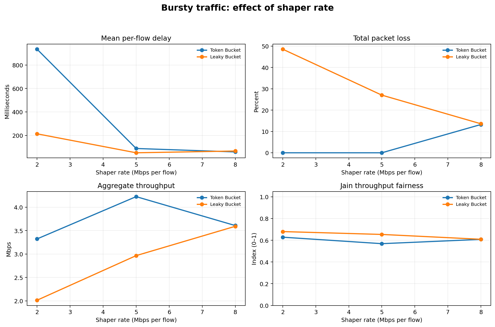
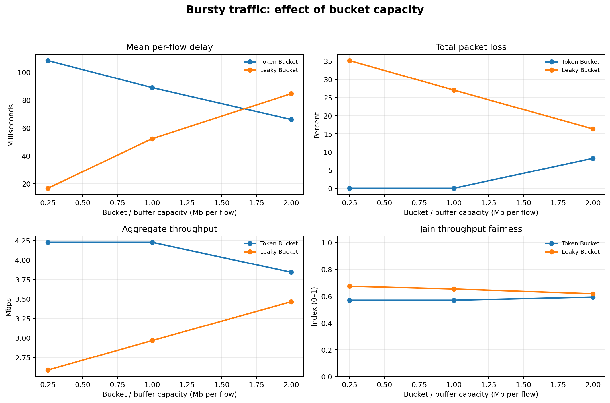
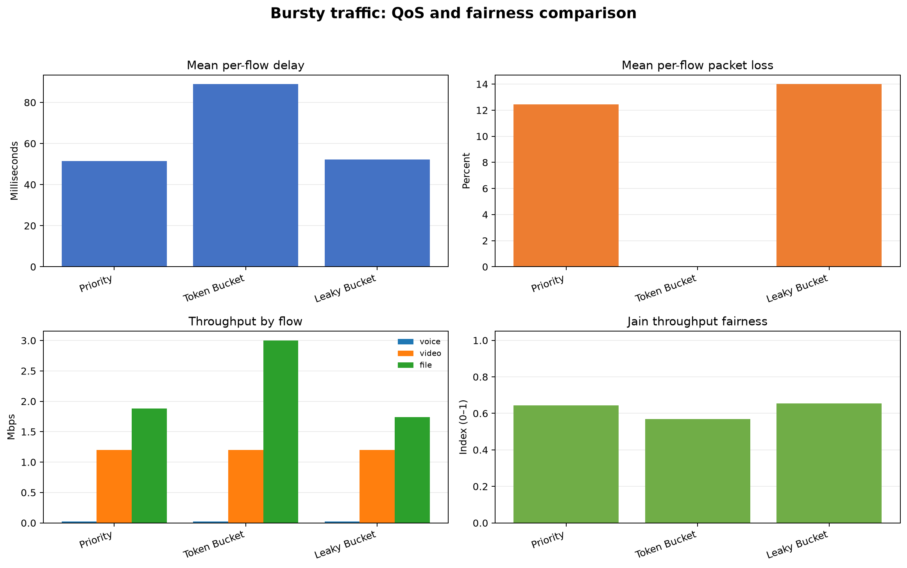
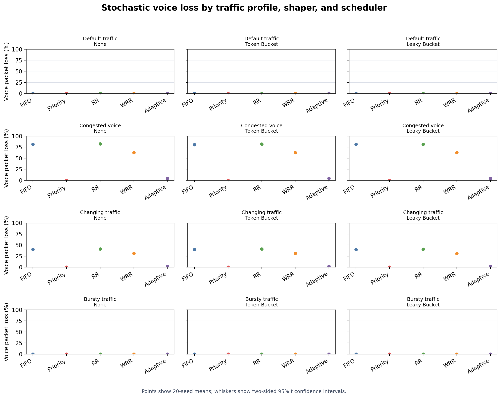

# Adaptive QoS Traffic Management and Fair Scheduling Simulator

## Abstract

This project implements a discrete-event simulator for a shared 10 Mbps network link. It compares FIFO, strict priority, Round Robin (RR), packet-based Weighted Round Robin (WRR), and Adaptive WRR scheduling. It also models Token Bucket and Leaky Bucket traffic shaping. Experiments examine scheduler behavior at several offered loads, under a voice-heavy and changing load, and with synchronized bursts. The simulator records throughput, packet loss, delay, jitter, queue occupancy, Jain's throughput fairness index, and adaptive controller decisions.

The results show that the mechanisms make different trade-offs. Strict priority protects latency-sensitive voice traffic when the voice queue is prioritized, while it can leave best-effort traffic with little capacity. Round Robin distributes service opportunities by packet count. WRR allocates packet opportunities according to configured weights. Shaping controls when packets enter the network queues, but can trade lower network loss for additional delay or drops at a finite shaper buffer.

## 1. Research question and objectives

**Research question:** How do traffic shaping and packet scheduling affect QoS and throughput fairness under congested and bursty network conditions?

The simulator is designed to:

1. Compare four packet scheduling algorithms on the same traffic traces.
2. Measure the delay, loss, throughput, jitter, and queue effects of each algorithm.
3. Compare unshaped traffic with Token Bucket and Leaky Bucket shaping.
4. Study the effect of offered load, shaper rate, and bucket capacity.
5. Compare a fixed scheduler with a feedback controller that adjusts voice service when its queue breaches QoS targets.

## 2. Simulation model

The simulator models a single shared link with a capacity of 10 Mbps. Traffic consists of voice, video, and file-transfer flows. Packets have a flow label, size, source generation time, and sequence number. A discrete-event event queue processes packet arrivals and transmission completions. Transmission time is packet size divided by link rate.

| Profile | Voice | Video | File | Total offered load |
|---|---:|---:|---:|---:|
| Default | 200-byte packets every 20 ms (0.08 Mbps) | 1,200-byte packets every 2 ms (4.8 Mbps) | 1,500-byte packets every 1 ms (12 Mbps) | 16.88 Mbps |
| Congested voice | 200-byte packets every 0.4 ms (4 Mbps) | 4.8 Mbps | 12 Mbps | 20.8 Mbps |
| Bursty | Default mix active in five synchronized 0.5-second windows | Same | Same | 8.44 Mbps averaged over 10 seconds; 16.88 Mbps during bursts |

The load sweep scales each flow's packet interval proportionally, preserving the default traffic mix, to target aggregate offered loads of 5, 10, 15, and 20 Mbps.

Each flow has its own queue, limited to 100 waiting packets. The packet currently in service is not included in that limit. The total waiting-queue capacity is therefore 300 packets for three flows. A full flow queue drops an arriving packet from that flow (tail drop). The link continues draining queued packets after the 10-second arrival window ends so accepted packets can receive completion times.

### Assumptions and scope

- The link has a fixed service rate and one packet is transmitted at a time.
- Source traffic is deterministic and periodic within each active interval; there is no random packet-size or arrival variation.
- The model does not include propagation delay, retransmissions, protocol overhead, multiple hops, or real operating-system/network-stack behavior.
- Queue limits are per flow. There is no shared-buffer allocation policy or active queue management.
- Strict priority has no starvation prevention. WRR assigns packet opportunities, so differently sized packets do not receive bandwidth shares exactly proportional to the weights.
- Shapers operate independently per flow. The experiment uses the same configured shaper rate and capacity for each flow.

## 3. Scheduling and shaping algorithms

### Schedulers

- **FIFO:** selects the queued packet with the earliest source arrival time. Sequence number breaks ties.
- **Strict Priority:** serves the highest-priority nonempty flow first: voice (3), video (2), then file (1). A continuously backlogged high-priority flow can starve lower-priority flows.
- **Round Robin:** cycles through nonempty flow queues, serving one packet per turn. This is packet-fair rather than byte-fair.
- **Weighted Round Robin:** serves up to 3 voice, 2 video, and 1 file packet per cycle when queues remain backlogged. This is also packet-based.
- **Adaptive WRR:** uses a smooth weighted service selector, starting at voice/video/file weights of 3:2:1. It raises voice's weight by one, up to 12, when the voice queue head waits longer than 20 ms or the queue reaches 12 packets. It decreases the weight toward 3 when voice head wait is below 5 ms and the queue has at most two packets. The controller records each weight change.

### Traffic shapers

- **Token Bucket:** tokens accumulate at the configured rate up to the bucket capacity. A packet is released when sufficient tokens are available; unused tokens permit a temporary burst. In these experiments the bucket starts full.
- **Leaky Bucket:** packets wait in a finite per-flow buffer and are released at a constant configured rate. If the buffer cannot accept a packet, the shaper drops it.

The shaper sweep uses rates of 2, 5, and 8 Mbps per flow and capacities of 0.25, 1, and 2 Mb per flow. The experiments use a Priority scheduler after shaping so scheduler policy is held fixed while shaper settings change.

## 4. Metrics

- **Delay:** packet completion time minus its original source generation time. For shaped packets, this includes shaping wait and network queueing.
- **Packet loss:** (network queue drops + shaper drops) / generated packets × 100.
- **Throughput:** successfully transmitted bits completed during the 10-second measurement window divided by 10 seconds.
- **Jitter:** mean absolute difference between consecutive completed packet delays for a flow.
- **Queue length:** total number of packets waiting in network flow queues. Average queue length is time-weighted over the measurement window; maximum is the peak total waiting queue length.
- **Jain's throughput fairness:**

  \[
  J = \frac{(\sum_{i=1}^{n} x_i)^2}{n\sum_{i=1}^{n} x_i^2}
  \]

  where \(x_i\) is the measured throughput of flow \(i\). The index ranges from 1/number-of-flows to 1, with 1 indicating equal raw throughput.

Metrics have different time windows by design: throughput counts completions inside the 10-second measurement window, while accepted packets are drained afterward and their completion delays are included in average delay and jitter. Thus the transmitted-packet count can include packets completed after the throughput window. Fairness is based on raw throughput, not the proportion of each flow's demand that was served; interpret it alongside loss and delay.

## 5. Experimental design

The script runs four experiment groups:

1. **Default traffic:** compare all five schedulers at 16.88 Mbps offered load.
2. **Congested voice:** compare all schedulers when voice alone offers 4 Mbps and total load is 20.8 Mbps.
3. **Changing traffic:** voice offers 4 Mbps from the beginning; video and file traffic join at 5 seconds, creating a sudden load increase.
4. **Offered-load sweep:** compare all schedulers at 5, 10, 15, and 20 Mbps.
5. **Bursty shaping sweep:** with Priority scheduling, compare unshaped traffic and both shapers across shaper rates and capacities.

All experiment settings and flow-level results are written to `results/experiment_results.csv`. The current run contains 138 flow-level rows. Each row records its scenario, scheduler, shaper, link and queue settings, offered load, shaping parameters, metrics, and adaptive controller summary. Weight changes are recorded in `results/adaptive_controller_trace.csv`.

## 6. Results and discussion

### Offered load

At 5 and 10 Mbps, all scheduler configurations deliver the offered load without packet loss in this deterministic traffic mix. At 15 and 20 Mbps, offered traffic exceeds link capacity: throughput levels off around 10 Mbps, while delay and loss rise. At 15 Mbps, mean per-flow delay is about 206 ms for FIFO and about 70 ms for Priority, RR, WRR, and Adaptive WRR; total loss is approximately 29% for all five. At 20 Mbps, mean per-flow delay is about 214 ms for FIFO, compared with about 93 ms for Priority and WRR and 141 ms for RR. These are results for the current flow mix and queue settings, not general guarantees about the algorithms.



### Congested voice and scheduler trade-offs

In the voice-heavy profile, strict Priority delivers all voice packets at 4 Mbps, with 0% voice loss and approximately 0.585 ms average voice delay. FIFO delivers only about 0.716 Mbps of voice and drops 81.71% of voice packets. The protection comes at the expense of file traffic: under Priority, file throughput is about 1.2 Mbps, file loss is 88.99%, and file average delay is about 910 ms.

WRR gives a different compromise in this profile: voice throughput is about 1.486 Mbps with 62.46% voice loss, while video receives its full 4.8 Mbps. Its Jain throughput index is higher than Priority in this particular run, but that reflects a more equal raw throughput distribution; it does not mean every flow's demand is better met.



### Adaptive WRR under changing traffic

When video and file traffic join at 5 seconds, fixed WRR delivers about 2.743 Mbps of voice, with 31.03% voice loss and 29.0 ms mean voice delay. Adaptive WRR detects the voice queue-depth breach and increases voice's weight from 3 to 12. It delivers about 3.903 Mbps of voice, reducing voice loss to 2.04% and mean voice delay to 19.1 ms. That protection reduces service for other flows: video loss rises to 16.64%, file loss to 78.14%, and file delay to about 466 ms. Jain's raw-throughput fairness index decreases from 0.976 under fixed WRR to 0.805 under Adaptive WRR. This is the intended QoS/fairness trade-off, and it shows why the controller needs clear targets and starvation safeguards.



The controller trace shows its response to the traffic step, including the voice weight, queue depth, and head-of-line wait used by the adaptation rule.



### Default scheduler comparison

The default profile also exceeds link capacity, mainly because file traffic offers 12 Mbps on its own. Priority lowers mean per-flow delay from about 213 ms under FIFO to about 77 ms, while aggregate loss remains around 36%. Priority protects short voice and video queues but still leaves a large file backlog. RR has a mean per-flow delay of about 135 ms and spreads packet service opportunities across flows.



### Shaper rate and capacity

For the synchronized burst profile, the 5 Mbps / 1 Mb Token Bucket setting has no packet loss in this run, while the unshaped profile loses about 24% of generated packets. The Token Bucket can turn burst excess into delayed packets: at 2 Mbps per flow and 1 Mb capacity, mean per-flow delay is about 935 ms. Raising the rate to 5 Mbps sharply reduces that delay, while 8 Mbps permits more burst load through and the network drops about 13% of packets.

The Leaky Bucket smooths output and keeps the network queue small, but its finite shaper buffer can drop packets. With a 5 Mbps drain rate, increasing capacity from 0.25 Mb to 2 Mb reduces total loss from about 35% to 16%, while mean per-flow delay rises from about 17 ms to 85 ms. The larger buffer retains more packets and lets them wait longer before release.







### Stochastic arrival robustness

The congested-voice scheduler comparison was repeated with independent Poisson packet arrivals at each source's configured mean rate. Twenty fixed seeds were used, with the same seed supplying the same traffic realization to each scheduler. The table reports mean voice loss and delay with two-sided 95% Student-t confidence intervals (19 degrees of freedom).

| Scheduler | Voice loss (%) | 95% CI | Voice delay (ms) | 95% CI |
|---|---:|---:|---:|---:|
| FIFO | 81.51 | 81.44–81.58 | 217.34 | 216.76–217.91 |
| Priority | 0.00 | 0.00–0.00 | 0.72 | 0.72–0.72 |
| Round Robin | 82.35 | 82.30–82.39 | 228.36 | 228.27–228.44 |
| Weighted Round Robin | 62.53 | 62.31–62.75 | 106.19 | 105.70–106.68 |
| Adaptive WRR | 4.46 | 4.23–4.69 | 36.52 | 36.12–36.92 |

Adaptive WRR substantially reduced voice loss and delay relative to FIFO, RR, and fixed WRR across these randomized runs, while strict Priority protected voice most strongly. These intervals describe run-to-run variability for this 10-second Poisson model; they do not establish that all real networks follow Poisson arrivals. Per-seed measurements are in `results/stochastic_seed_results.csv`, and grouped means and confidence bounds are in `results/stochastic_summary.csv`.

Because each scheduler was evaluated against the same traffic trace for each seed, paired differences were also calculated. Each table entry is the comparator's metric minus Adaptive WRR's metric; the 95% confidence interval is computed over the 20 paired seed differences. For loss and delay, negative values favor Adaptive WRR. For fairness, positive values favor Adaptive WRR. The intervals are descriptive, unadjusted intervals for this experiment and should not be read as a multiple-comparison corrected hypothesis test.

| Comparator | Voice loss difference (percentage points) | Voice delay difference (ms) | Jain fairness difference |
|---|---:|---:|---:|
| FIFO | +77.05 (76.87 to 77.23) | +180.82 (180.28 to 181.36) | -0.210 (-0.210 to -0.209) |
| Priority | -4.46 (-4.69 to -4.23) | -35.80 (-36.20 to -35.40) | -0.139 (-0.143 to -0.135) |
| Round Robin | +77.88 (77.70 to 78.07) | +191.84 (191.44 to 192.23) | -0.209 (-0.209 to -0.209) |
| Weighted Round Robin | +58.07 (57.90 to 58.24) | +69.67 (69.06 to 70.29) | -0.108 (-0.110 to -0.106) |

The paired results sharpen the interpretation: Priority delivers better voice loss and delay than Adaptive WRR in this stress profile, but Adaptive WRR produces a higher Jain fairness index across all flows. The per-seed paired results for all recorded metrics are in `results/stochastic_paired_comparisons.csv`.

The stochastic comparison was then expanded to four traffic profiles, three per-flow shaper configurations (none, Token Bucket, and Leaky Bucket), and all five schedulers. The two shapers used a 5 Mbps rate and 1 Mb capacity per flow. This is 60 profile/shaper/scheduler combinations, each evaluated with the same 20 Poisson seeds. Across the expanded matrix, Priority had zero voice loss for every profile and shaper setting. Adaptive WRR's mean voice loss was 4.46% in congested voice traffic and 2.04% in changing traffic; it was zero in the default and bursty profiles. At these selected shaper settings, Token Bucket did not change the voice loss results, while Leaky Bucket increased mean voice delay slightly. This illustrates that shaper settings should be evaluated alongside the source rates and the scheduler.



## 7. Conclusion

The experiments demonstrate that scheduling and shaping redistribute delay, loss, and throughput rather than removing the effects of overload. Priority can protect voice when its queue is prioritized, but can starve file traffic. RR and WRR distribute service opportunities more broadly, with their outcomes affected by packet sizes and weights. Adaptive WRR responds to measured voice queue pressure and lowers voice loss in the traffic-step experiment, at a cost to lower-priority traffic and raw throughput fairness. Token Bucket shaping accommodates bursts by delaying packets when tokens are unavailable; Leaky Bucket shaping smooths output but can drop packets when its finite buffer fills.

For the selected deterministic profiles, the main finding is that a QoS policy must match the traffic objective. A latency-sensitive flow benefits from strict priority, while a policy that protects all classes from starvation needs some form of weighted or minimum-rate allocation. Shaper rate and capacity must be chosen together: lower rates smooth more aggressively but increase waiting, while larger buffers reduce drops at the cost of delay.

## 8. Limitations and future work

- Test additional arrival distributions, including measured or burst-correlated traces, beyond the Poisson model used in the robustness experiment.
- Compare packet-based WRR with byte-based or deficit round robin to account for packet-size differences.
- Add a shared-buffer option and compare it with the current per-flow queue limits.
- Add priority starvation safeguards, such as a minimum service share for best-effort traffic.
- Tune adaptive thresholds and recovery behavior, and compare with minimum-rate guarantees for video and file traffic.
- Sweep queue limits, link capacities, and traffic mixes in addition to shaping parameters.
- Increase the stochastic seed count and apply multiple-comparison corrections when making formal significance claims across the full matrix.
- Test additional arrival distributions, including measured or burst-correlated traces, beyond the Poisson model used in the robustness experiment.
- Compare simulator results with a packet-level network simulator or a small real testbed.

## 9. Reproduction

From the project directory, run:

```bash
python3 qos_simulator.py
```

The command prints the baseline comparisons and regenerates the CSV files and plots under `results/`. It also runs the 20-seed Poisson-arrival matrix across four profiles, three shaper settings, and five schedulers. Raw seed-level, summary, and paired-comparison data are saved as `results/stochastic_seed_results.csv`, `results/stochastic_summary.csv`, and `results/stochastic_paired_comparisons.csv`. The simulator is implemented in `qos_simulator.py`; the deterministic experiment data is in `results/experiment_results.csv`.
